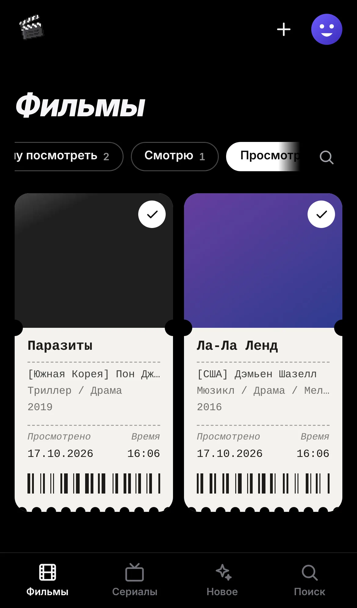

# Films & Serials For You

Домашний кинотеатр. Ставите приложение на Mac или Windows, показываете папку с фильмами и
сериалами — и получаете красивый сайт: карточки-билеты в цвет постера, описания, актёры,
рейтинг IMDb, серии по сезонам. Друзья открывают постоянную бесплатную ссылку и смотрят онлайн
или скачивают. Фильмы лежат на вашем компьютере, управляете всем вы.




## Что умеет

**Каталог как у Apple TV**
- Главная — большой кадр с названием, жанром и описанием (листается сам) и ряды широких
  карточек: «Продолжить просмотр», «Новое», «Хочу посмотреть», «Фильмы», «Сериалы», жанры.
- Вкладки **«Фильмы»** и **«Сериалы»** с фильтрами **«Хочу посмотреть», «Смотрю»,
  «Просмотрено»**.
- **Где остановились — видно всегда**: полоска на карточке, «осталось 23 мин», «1 сезон,
  4 серия» у сериала; досмотрели — «Просмотрено» само.
- Один аккаунт — один человек: свои статусы, история, оценки, фото.
- **«Совпадение 95 %»** — по вашей истории и оценкам 👎 «Не для меня», 👍 «Нравится», ❤ «Обожаю».
- **Плеер**: адаптивное качество (HLS, «Авто» подстраивается под скорость интернета, сам
  включается при подвисаниях), кадры при наведении на полосу перемотки, «Пропустить заставку»,
  карточка следующей серии на титрах, продолжение с того же места, выбор озвучки и субтитров
  (и их вида: плашка, тень, обводка, жёлтые, размер). MKV и HEVC — «готовой копией» без
  перекодирования: Safari и окно на Mac играют и перематывают.
- Ставится на телефон как приложение (с главного экрана, без браузерной строки).

**Люди**
- Регистрация сама, без приглашений; своё фото.
- **Смотрим вместе** — совместные списки с друзьями: добавляйте фильмы, отмечайте
  «Посмотрели вместе».
- Отзывы и комментарии с оценками в звёздах, лайки; средняя оценка сайта на странице фильма.
- Друзья и чаты: обсуждайте фильмы, присылайте их друг другу карточкой.

**Своё**
- **Само подтягивает описания** с IMDb (без ключей): название по-русски, рейтинг, жанры,
  режиссёр, актёры с фото, кадры для галереи, серии с названиями. Можно переключить на TMDB или
  Кинопоиск — там сюжет на русском.
- **Понимает имена файлов**: `Начало (2010)/Inception.2010.1080p.mkv`, `Show.S01E02.mkv`,
  `Сериал/2 сезон/Серия 7.mp4`, `poster.jpg` рядом с фильмом.
- **Любой формат**: MP4 играет как есть, MKV/AVI/AC3/HEVC — через ffmpeg (он кладётся в
  установщик). Субтитры `.srt` рядом с видео (в том числе в Windows-1251) и встроенные.
- **Заставка и титры**: по главам файла или отметкам хоста прямо в плеере — на весь сезон.
- **Доступ для друзей**: по ссылке-приглашению; из интернета — бесплатная постоянная ссылка
  CloudPub (`https://….cloudpub.ru`, открывается в России с VPN и без, роутер настраивать не
  нужно), запасной туннель fxTunnel или свой адрес.
- **Обновляется само** с GitHub: «Обновить сейчас?» — и через минуту новая версия.
- **Добавить фильмы — проще некуда**: своя папка (положил — появилось), перетаскивание в окно
  приложения, загрузка из браузера с телефона; новое в папках появляется само.
- **Управление**: папки, каталог (название, описание, возраст, свой постер, скрыть), люди и
  роли, запрет скачивания, «кто сейчас смотрит».
- Быстро и экономно: один файл на Rust (сервер + интерфейс), SQLite, без Java и Docker;
  главная — ~55 КБ сжатого кода, лёгкие постеры, карточки вне экрана не рисуются.
- Надёжно: тесты сервера со сквозными сценариями на настоящем ffmpeg и проверки Playwright на
  телефоне, планшете и компьютере — ни один элемент не наезжает на другой и не шире экрана.

## Установка

Скачайте установщик со страницы [выпусков](../../releases): `.dmg` для Mac (aarch64 — Apple
Silicon, x64 — Intel) или `.exe` для Windows.

На Mac приложение подписано «для себя», без сертификата Apple: при первом запуске macOS
спросит, открыть ли его, — нажмите на значок правой кнопкой → «Открыть» (на macOS 15 и новее:
«Системные настройки → Конфиденциальность и безопасность → Всё равно открыть»). Если macOS пишет
«приложение повреждено» (так было с 0.3.0), выполните в Терминале
`xattr -cr "/Applications/Films and Serials For You.app"` или поставьте 0.3.1 и новее.
Подробно для хоста — [docs/host.md](docs/host.md).

## Разработка

Нужны Rust (stable) и Node 22. Для приложения на Linux — `libwebkit2gtk-4.1-dev`.

```
make dev          # сервер на :17480 + интерфейс на :5173 с горячей перезагрузкой
make test         # тесты сервера (нужен ffmpeg) и интерфейса
make e2e          # Playwright против собранного сервера: вёрстка, статусы, скорость
make lint         # rustfmt, clippy, svelte-check
make build        # target/release/fsfy — сервер с встроенным интерфейсом
make desktop      # установщик для этой ОС
cargo run -p fsfy-server -- serve --data ./data-dev   # сервер без приложения
```

Выпуск: тег `vX.Y.Z` (как `version` в `desktop/src-tauri/tauri.conf.json`) → GitHub Actions соберёт
`.dmg` и `.exe` и опубликует выпуск.

## Устройство

```
server/   Rust: axum, SQLite (rusqlite), разбор файлов, IMDb/TMDB/Кинопоиск, поток видео, туннель
web/      SvelteKit (SPA) → web/build → встраивается в сервер
desktop/  Tauri 2: окно, трей, выбор папки; сервер работает внутри приложения
```

Лицензия — AGPL-3.0.
