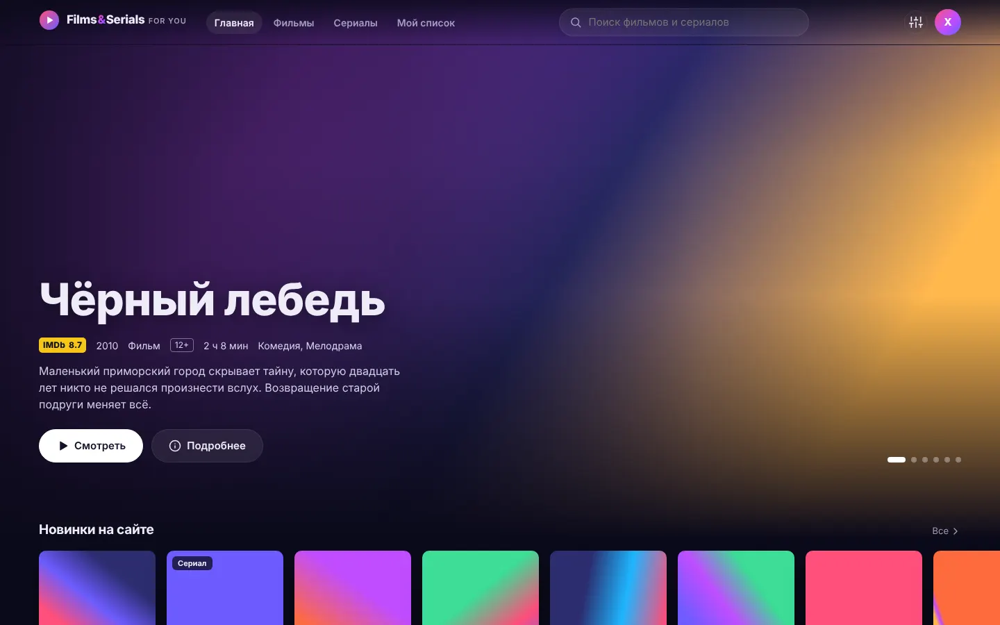
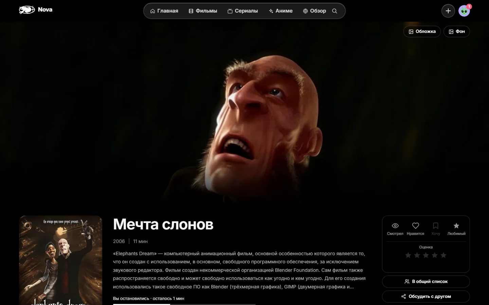
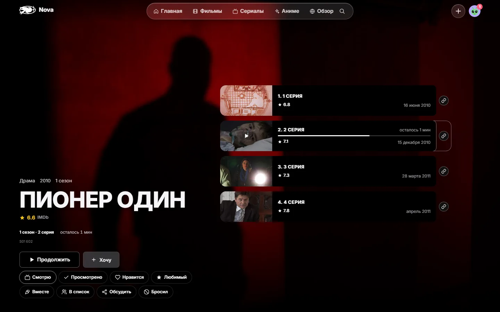
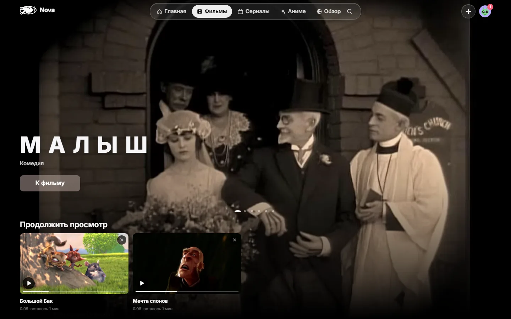
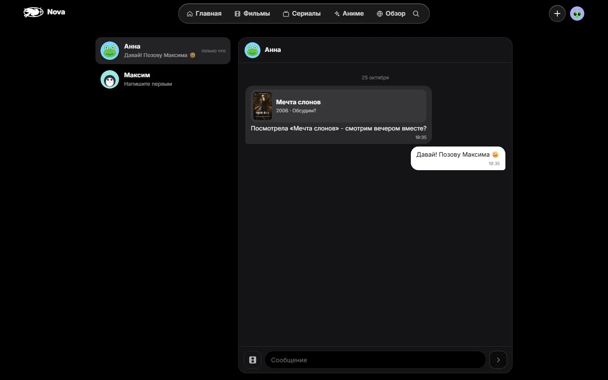
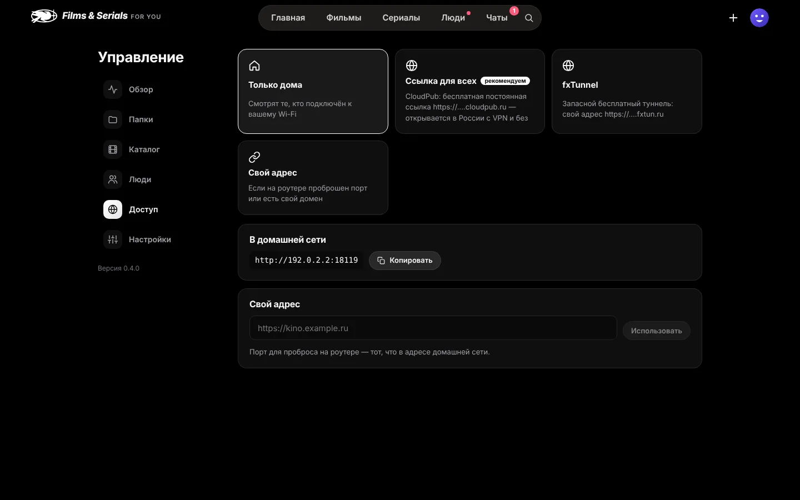
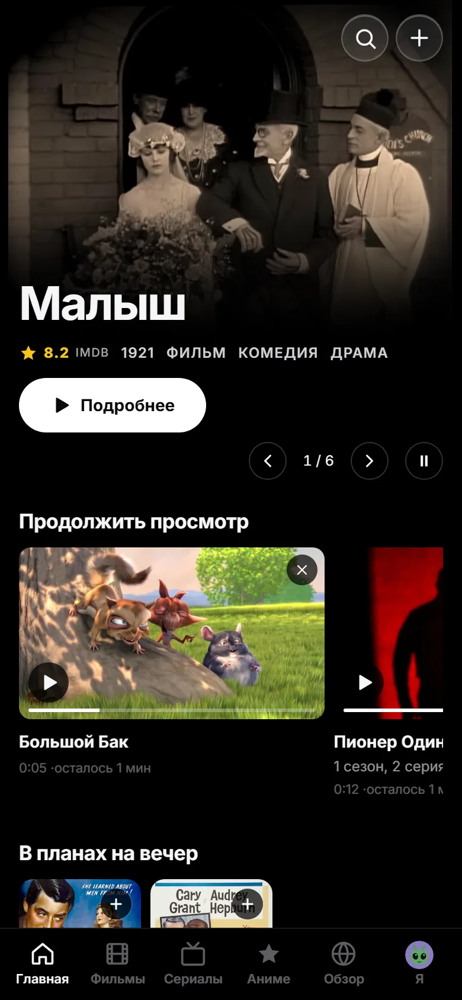
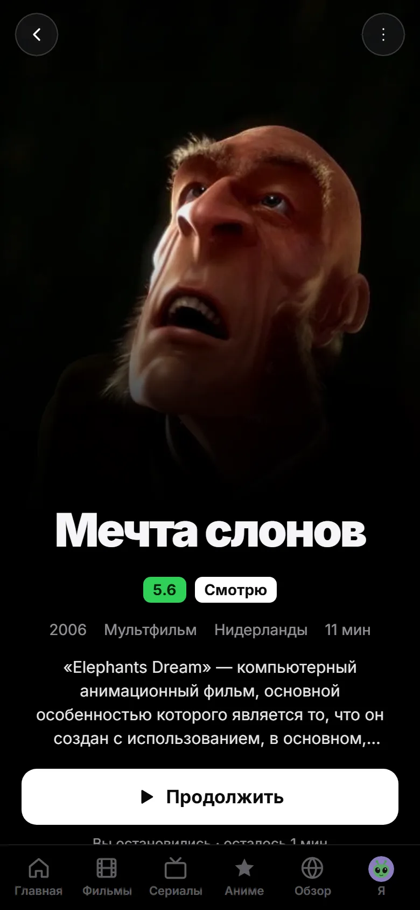
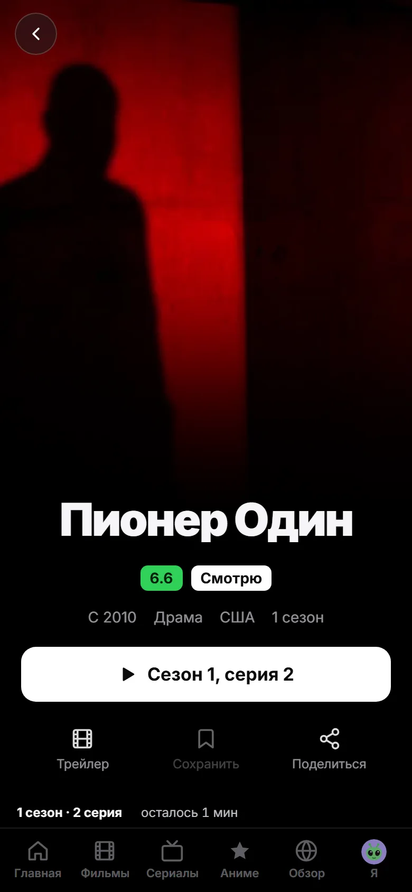

<p align="center">
  
</p>

<h1 align="center">Nova</h1>

<p align="center">
  <b>Свой кинотеатр из папки с фильмами.</b><br>
  Ставите приложение на компьютер, показываете папку - и получаете красивый сайт с постерами,<br>
  описаниями и сериями. Друзья смотрят по ссылке в браузере, фильмы остаются у вас.
</p>

<p align="center">
  
  
  
  
  
</p>



## Как это выглядит

Все снимки - настоящая Nova: папка с фильмами, описания, постеры и кадры сервер сам взял с IMDb.

<table>
  <tr>
    <td width="50%"><br><sub><b>Страница фильма</b> - кадр, постер, описание, где остановились, оценки и отметки</sub></td>
    <td width="50%"><br><sub><b>Сериал</b> - серии с кадрами, названиями и оценками IMDb, «Продолжить» с нужной серии</sub></td>
  </tr>
  <tr>
    <td><br><sub><b>Фильмы</b> - своя подборка, «Продолжить просмотр», популярное и топ-250 IMDb</sub></td>
    <td><br><sub><b>Друзья и чаты</b> - фильм карточкой прямо в сообщении</sub></td>
  </tr>
  <tr>
    <td colspan="2"><br><sub><b>Управление для хоста</b> - всё ли работает, кто смотрит, папки, доступ из интернета</sub></td>
  </tr>
</table>

<table>
  <tr>
    <td width="33%"></td>
    <td width="33%"></td>
    <td width="33%"></td>
  </tr>
  <tr>
    <td align="center"><sub>Главная на телефоне</sub></td>
    <td align="center"><sub>Фильм: трейлер в кадре, «Продолжить»</sub></td>
    <td align="center"><sub>Сериал: сезоны вкладками</sub></td>
  </tr>
</table>

## Что умеет

### Смотреть
- **Любые файлы**: MP4 играет как есть, MKV, AVI, HEVC, AC3 - через ffmpeg (он уже в установщике).
  Плеер замеряет скорость до вашего компьютера и сам выбирает качество, при подвисании - снижает; несколько озвучек и субтитров, `.srt` рядом с видео
  (в том числе в Windows-1251).
- **Место запоминается на всех устройствах**: начали на ноутбуке - продолжите на компьютере
  или телефоне с той же секунды.
- **Сериалы как надо**: сезоны, названия и кадры серий, «Пропустить заставку», следующая серия
  на титрах, сетка оценок серий.
- **Смотреть вместе**: комната по ссылке, пауза и перемотка у всех сразу, чат, реакции и голос.
  Можно в любой момент выйти и досмотреть одному.
- **Трейлеры в HD** прямо в кадре страницы фильма.
- **Видео по ссылке**: Rutube, VK Видео, YouTube и прямые ссылки на `.mp4` и `.m3u8` играют
  внутри Nova.
- **Скачать** фильм, сезон или весь сериал одним архивом (хост может запретить).

### Находить
- **Описания сами**: IMDb без ключей - русское название, сюжет, жанры по-русски, актёры с фото,
  режиссёр, кадры. Можно переключить на TMDB или Кинопоиск.
- **Понимает имена файлов**: `Начало (2010)/Inception.2010.1080p.mkv`, `Show.S01E02.mkv`,
  `Сериал/2 сезон/Серия 7.mp4`, `poster.jpg` рядом с фильмом.
- **Обзор**: популярное и топ-250 IMDb, поиск по всему IMDb, «Потому что вам понравилось»,
  у каждого фильма своя страница. Нет у хоста - кнопка «Хочу на Nova».
- **Франшизы по порядку** и фильмография режиссёров.

### Вместе с друзьями
- Регистрация сама, без приглашений. Аватарки - свои нарисованные персонажи.
- Статусы «Хочу», «Смотрю», «Просмотрено», «Больше не смотрю», звёзды, отзывы и лайки.
- Друзья, переписка, общие списки, «Друзья смотрят» и «Сейчас смотрит».
- Профиль со статистикой: часы, жанры, любимые фильмы и режиссёры.

### Для хоста
- **Добавить фильм** - положить в папку, перетащить в окно приложения или загрузить с
  телефона. Новое появляется само.
- **Доступ из интернета** без настройки роутера: постоянная бесплатная ссылка CloudPub, запасной
  туннель или свой адрес.
- **Управление**: состояние одним взглядом, папки, каталог (название, описание, постер, «не тот
  фильм»), люди и роли, кто сейчас смотрит.
- **Быстро и бережно**: один сервер на Rust с SQLite внутри приложения, без Docker и Java.
  Фоновая работа ffmpeg не мешает компьютеру, интерфейс сжат и грузится за доли секунды.
- **Безопасно**: пароли - Argon2id, сессии только хешем, защита от подбора и подделки запросов,
  смена пароля закрывает все прочие входы.

## Установка

1. Скачайте `Nova_0.2.0-alpha_x64-setup.exe` со страницы [выпусков](https://github.com/mitaro-cs/Nova/releases/latest) (Windows 10 и 11, x64) и запустите.
2. При первом запуске выберите папку с фильмами - Nova найдёт фильмы и сериалы сама.
3. «Управление → Доступ» - включите ссылку для друзей и отправьте её.

Данные хоста (база, картинки) лежат в `%APPDATA%\app.fsfy` и переживают переустановку.
**Обновляется само**: приложение находит новую версию на GitHub, ставит только подписанную ключом Nova
и перед установкой сохраняет копию базы в `backups/`. Подробно для хоста - [docs/host.md](docs/host.md).

Nova можно собрать и на Mac (см. ниже), но готовые выпуски сейчас - только для Windows.

## Разработка

Нужны Rust (stable), Node 22+ и ffmpeg.

```bash
make dev          # сервер на :17480 + интерфейс на :5173 с горячей перезагрузкой
make test         # тесты сервера (с настоящим ffmpeg) и интерфейса
make e2e          # Playwright: телефон, планшет, компьютер, iPhone (WebKit)
make lint         # rustfmt, clippy, svelte-check
make screenshots  # снимки для этого README (нужен интернет)
make desktop      # установщик для этой ОС
```

Сборка установщика для Windows - в `desktop/`:

```bash
npm ci
npm run tauri -- build --target x86_64-pc-windows-msvc --bundles nsis
```

### Устройство

```
server/   Rust: axum, SQLite, разбор имён файлов, IMDb/TMDB/Кинопоиск, поток видео, комнаты, туннель
web/      TypeScript + Svelte 5 (SvelteKit, SPA) - встраивается в сервер
desktop/  Tauri 2: окно, трей, выбор папки; сервер работает внутри приложения
```

Проверки перед выпуском: `cargo fmt`, `clippy`, тесты сервера, `svelte-check`, unit-тесты и
сквозные тесты Playwright: ни один элемент не наезжает на другой, страница не шире экрана, ничего
не дёргается при загрузке.

## Благодарности

На снимках - открытые фильмы [Blender Studio](https://studio.blender.org/films/) (CC BY),
сериал «Pioneer One» (CC BY-NC-SA) и классика в общественном достоянии. Описания и картинки -
с IMDb, как у любого хоста Nova.

Лицензия - [AGPL-3.0](LICENSE).
