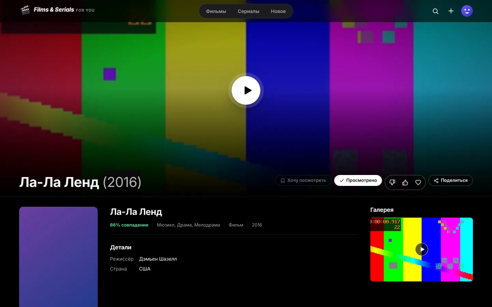

# Films & Serials For You

Домашний кинотеатр в стиле Netflix. Ставите приложение на Mac или Windows, показываете папку с
фильмами и сериалами — и получаете красивый сайт: постеры, описания, актёры, рейтинг IMDb, серии
по сезонам. Друзья открывают ссылку и смотрят онлайн или скачивают. Фильмы лежат на вашем
компьютере, управляете всем вы.




## Что умеет

**Как в Netflix**
- **«Кто смотрит?»** — до 6 профилей в аккаунте: у каждого своя история, «Мой список», оценки и
  подборки. **Детский профиль** видит только мультфильмы и то, что до 12+.
- **Персональная главная**: большой кадр с превью (фильм тихо начинает играть сам), «Продолжить
  просмотр», **Топ-10 за неделю** с огромными цифрами, «Потому что вы смотрели…», «Подобрано для
  вас», «Новые серии», ряды по жанрам.
- **«Совпадение 95 %»** — по вашей истории и оценкам 👎 «Не для меня», 👍 «Нравится»,
  ❤ «Обожаю»; то, что «не для меня», больше не предлагается.
- **Карточка при наведении**: кадр, «Смотреть», «В список», оценка, возраст, жанры.
- **Плеер**: адаптивное качество (HLS, «Авто» подстраивается под скорость интернета, сам
  включается при подвисаниях), кадры при наведении на полосу перемотки, «Пропустить заставку»,
  карточка следующей серии на титрах, продолжение с того же места, выбор озвучки и субтитров.
- Ставится на телефон как приложение (с главного экрана, без браузерной строки).

**Своё**
- **Само подтягивает описания** с IMDb (без ключей): название по-русски, рейтинг, жанры,
  режиссёр, актёры с фото, кадры для галереи, серии с названиями. Можно переключить на TMDB или
  Кинопоиск — там сюжет на русском.
- **Понимает имена файлов**: `Начало (2010)/Inception.2010.1080p.mkv`, `Show.S01E02.mkv`,
  `Сериал/2 сезон/Серия 7.mp4`, `poster.jpg` рядом с фильмом.
- **Любой формат**: MP4 играет как есть, MKV/AVI/AC3/HEVC — через ffmpeg (он кладётся в
  установщик). Субтитры `.srt` рядом с видео (в том числе в Windows-1251) и встроенные.
- **Заставка и титры**: по главам файла или отметкам хоста прямо в плеере — на весь сезон.
- **Доступ для друзей**: по ссылке-приглашению; из интернета — бесплатный туннель fxTunnel
  (`https://имя.fxtun.ru`, работает из России, роутер настраивать не нужно) или свой адрес.
- **Управление**: папки, каталог (название, описание, возраст, свой постер, скрыть), люди и
  роли, запрет скачивания, «кто сейчас смотрит».
- Быстро и экономно: один файл на Rust (сервер + интерфейс), SQLite, без Java и Docker;
  лёгкие постеры для рядов, кадры перемотки декодируются только по ключевым кадрам.

## Установка

Скачайте установщик со страницы [выпусков](../../releases): `.dmg` для Mac (aarch64 — Apple
Silicon, x64 — Intel) или `.exe` для Windows.

На Mac приложение пока не подписано: при первом запуске нажмите на значок правой кнопкой →
«Открыть». Подробно для хоста — [docs/host.md](docs/host.md).

## Разработка

Нужны Rust (stable) и Node 22. Для приложения на Linux — `libwebkit2gtk-4.1-dev`.

```
make dev          # сервер на :17480 + интерфейс на :5173 с горячей перезагрузкой
make test         # тесты сервера (нужен ffmpeg) и интерфейса
make lint         # rustfmt, clippy, svelte-check
make build        # target/release/fsfy — сервер с встроенным интерфейсом
make desktop      # установщик для этой ОС
cargo run -p fsfy-server -- serve --data ./data-dev   # сервер без приложения
```

Выпуск: тег `v0.1.0` → GitHub Actions соберёт `.dmg` и `.exe` и опубликует выпуск.

## Устройство

```
server/   Rust: axum, SQLite (rusqlite), разбор файлов, IMDb/TMDB/Кинопоиск, поток видео, туннель
web/      SvelteKit (SPA) → web/build → встраивается в сервер
desktop/  Tauri 2: окно, трей, выбор папки; сервер работает внутри приложения
```

Лицензия — AGPL-3.0.
